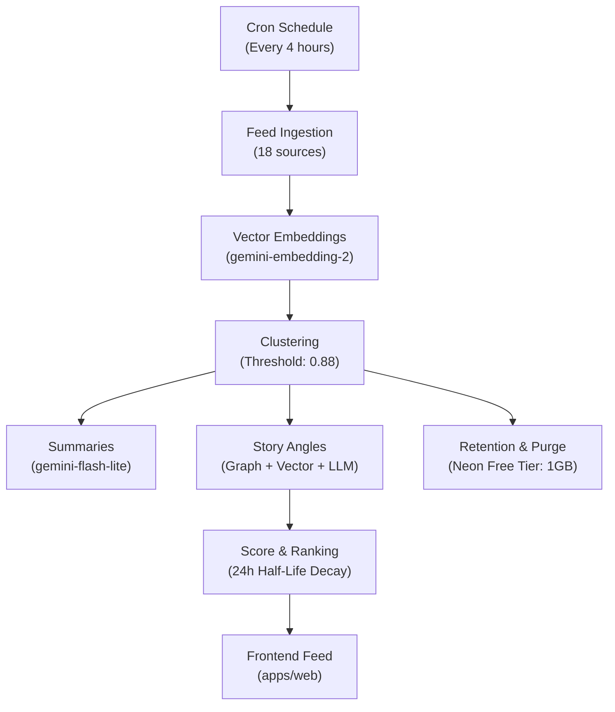
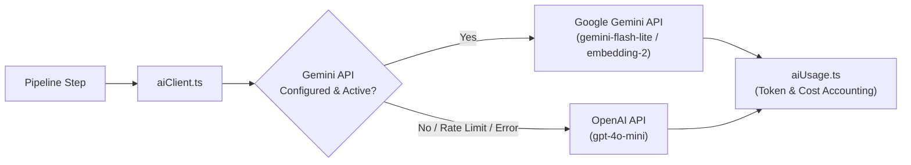

# Neus Pipeline Architecture & Engineering Reference

This document provides the canonical architectural reference for the Neus backend pipeline. It details the operating philosophy, end-to-end processing stages, cost constraints, safety mechanisms and the complex web of interdependent variables that govern the platform.

---

## 1. Operating Philosophy & Core Directives

### The Delicate Balancing Act: Hobby Economics vs Editorial Accuracy
Neus is an independent news aggregation platform created with an emphasis on **neutrality, trust and thoughtful consumption**. 

It is also an **unfunded personal hobby project**, maintained out-of-pocket by an individual developer. It is not a venture-backed startup and generates zero commercial revenue.

This creates a fundamental operational tension:
- **Editorial Standard**: Articles must be accurately clustered by event, stories must present multi-perspective angles neutrally, headlines and summaries must be concise and balanced and low-quality or clickbait articles must not dominate.
- **Economic Reality**: The operational budget is strictly constrained to **£5 to £10 per month** across all AI compute and cloud infrastructure.

Every cloud API call (Gemini input/output tokens, text embeddings and OpenAI fallback requests) debits real money from a personal prepaid account. A single poorly designed loop or un-cached re-classification can deplete an entire month's budget in a few hours.

> **The Golden Rule of Neus Engineering:**
> **Deterministic computation first; LLM completion last.**
> Never use an LLM for any task that can be accomplished with local vector mathematics, PostgreSQL indexes, deterministic heuristics, regex or structured caching. When an LLM is necessary, prompts must be compact, batched, defensive and strictly targeted to resolving genuine ambiguity.

### Incremental Iteration & The Law of Small Changes
Because of the tight coupling between pipeline components, **never deploy large, sweeping or speculative multi-system changes in a single PR**.

When modifying pipeline logic, scoring formulas, clustering algorithms or prompts:
1. **Isolate a single variable**: Formulate a clear hypothesis (for example: "Pre-filtering article assignments with cosine similarity will eliminate redundant re-classifications on existing multi-angle stories").
2. **Test locally with zero API cost**: Run unit tests and pipeline simulation tests with mocked AI clients ([`apps/engine/core/pipeline/simulation.test.ts`](file:///Users/jwalton/Code/cobacious/neus/apps/engine/core/pipeline/simulation.test.ts)) to verify that call counts, execution times and logic match expectations.
3. **Verify against production telemetry**: Deploy incrementally and inspect the GitHub Actions pipeline summary tables, step execution timings, token counts and spend metrics.
4. **Observe across multiple cron cycles**: Watch for edge cases or unexpected second-order effects over 24 to 48 hours before proceeding to the next change.

### System Interdependence: The Matrix of Variables
Neus is not a set of isolated scripts; it is an interdependent data ecosystem. Modifying any parameter produces cascading second-order and third-order effects across compute, storage, token burn and user experience:

| Variable | Current Value | Primary Purpose | Downstream Impact if Modified |
| :--- | :--- | :--- | :--- |
| `CLUSTER_SIMILARITY_THRESHOLD` | `0.88` | Cosine threshold to group unclustered articles into event clusters | **Lowering (< 0.82)**: Merges disparate events into messy clusters, diluting neutrality. **Raising (> 0.90)**: Fragments stories into micro-clusters, increasing cluster count, multiplying summary LLM calls and ballooning database rows. |
| `STORY_ANGLE_THRESHOLD` | `0.70` | Cosine similarity to connect related clusters into candidate story neighborhoods | **Lowering (< 0.65)**: Forms oversized connected graphs bridging unrelated topics. **Raising (> 0.78)**: Fails to detect legitimate distinct angles of the same breaking story. |
| Lookback Window (`getUnclusteredArticles`) | `3 days` | Window for considering unassigned articles for clustering | **Shortening (< 2 days)**: Drops older developing articles, preventing late-breaking updates from joining existing clusters. **Lengthening (> 5 days)**: Quadratic $O(N^2)$ explosion in graph traversal over thousands of solitary articles. |
| Story Discovery Lookback | `30 days` | Window for candidate clusters in story angle organization | Necessary to connect multi-day developing stories. Requires defensive checks (`hasRecentActivity`) to avoid re-evaluating settled stories. |
| Unclustered Article Retention | `7 days` | Hard deletion of unclustered solitary articles | **Extending (> 14 days)**: Unclustered articles accumulate (2,500+ rows), approaching Neon's 1 GB free storage limit and slowing vector queries. |
| Cluster Archive Window | `30 days` | Archives old clusters and prunes heavy text and vectors | Balances historical archive permalinks against database storage ceilings. |
| Recency Half-Life (`HALF_LIFE_HOURS`) | `24 hours` | Exponential decay rate for feed ranking in [`scoreCluster.ts`](file:///Users/jwalton/Code/cobacious/neus/apps/engine/core/pipeline/scoreCluster.ts) | **Shortening (< 12h)**: Rapid turnover; stories vanish quickly, favoring raw freshness over depth. **Lengthening (> 48h)**: Stagnant front page; yesterday's major news stays at the top even with no new developments. |
| Cron Schedule | `Every 4 hours` | External execution cadence via `cron-job.org` | **Hourly**: 6x multiplier on embedding calls, summary checks and Neon compute hours. **Daily (24h)**: News is stale on arrival; batch sizes cause timeout risks. |

---

## 2. End-to-End Pipeline Stages

The pipeline is orchestrated by [`runPipeline()`](file:///Users/jwalton/Code/cobacious/neus/apps/engine/core/pipeline/pipeline.ts#L20) and executes 15 distinct, sequential steps.

### Step 1: Ingest Sources (`ingest-sources`)
- **File**: [`packages/db/src/sources/getActiveSources.ts`](file:///Users/jwalton/Code/cobacious/neus/packages/db/src/sources/getActiveSources.ts)
- **Goal**: Retrieve the list of active, configured news feeds.
- **Cost**: Zero AI cost. Single fast PostgreSQL query.
- **Safeguard**: Inactive sources or deactivated feeds (such as *The Sun*) are filtered out at the database level.

### Step 2: Feed Ingestion (`ingest`)
- **File**: [`apps/engine/core/pipeline/ingestArticles.ts`](file:///Users/jwalton/Code/cobacious/neus/apps/engine/core/pipeline/ingestArticles.ts)
- **Goal**: Fetch and parse RSS/Atom XML feeds across all active news organizations (such as BBC, Guardian, Sky News, Financial Times, Reuters, AP).
- **Cost**: Zero AI cost. Parallel HTTP requests using native fetch and standard XML parsing.
- **Safeguard**: 10s per-feed network timeout; invalid XML payloads are caught and logged without failing the run.

### Step 3: Article Storage & Deduplication (`store`)
- **File**: [`apps/engine/core/pipeline/storeArticles.ts`](file:///Users/jwalton/Code/cobacious/neus/apps/engine/core/pipeline/storeArticles.ts)
- **Goal**: Deduplicate incoming feed items against the database and insert new records.
- **Cost**: Zero AI cost.
- **Safeguard**: Deduplication via unique URL indexing and database-level upserts (`syncArticles`).

### Step 4: Content Extraction (`fetch`)
- **File**: [`apps/engine/core/pipeline/fillMissingContent.ts`](file:///Users/jwalton/Code/cobacious/neus/apps/engine/core/pipeline/fillMissingContent.ts)
- **Goal**: Extract readable article text for articles lacking full body content in their RSS payload.
- **Cost**: Zero AI cost. Uses `@extractus/article-extractor` over HTTP.
- **Safeguard**:
  - **Paywall Skip**: Feeds flagged as paywalled (`paywalled: true` on `Source`, covering The Times, FT, Telegraph) skip scraping entirely, relying on the RSS title and snippet.
  - **Failure Marking**: Articles that fail extraction are marked as resolved to prevent infinite retry loops on subsequent runs.
  - **Concurrency & Batch Caps**: Limited to 5 concurrent fetches with a per-article timeout to prevent pipeline hangs.

### Step 5: Vector Embedding (`embed`)
- **File**: [`apps/engine/core/pipeline/embedArticles.ts`](file:///Users/jwalton/Code/cobacious/neus/apps/engine/core/pipeline/embedArticles.ts)
- **Goal**: Convert article title, snippet and leading text into a 768-dimensional semantic vector embedding.
- **Model**: `gemini-embedding-2` (Google Cloud Generative Language API).
- **Cost Profile**: Highly economical (~$0.20 per 1M tokens). Typically £0.02 to £0.04 per pipeline run.
- **Safeguards**:
  - **Native Batching**: Uses Gemini `batchEmbedContents`, sending up to 100 articles in a single HTTP request instead of sequential per-article calls.
  - **Payload Capping**: Input text is truncated to headline and lead summary to avoid embedding hundreds of kilobytes of boilerplate.

### Step 6: Story Clustering (`cluster`)
- **File**: [`apps/engine/core/pipeline/clusterArticles.ts`](file:///Users/jwalton/Code/cobacious/neus/apps/engine/core/pipeline/clusterArticles.ts)
- **Goal**: Group articles covering the same specific news event into a single cluster.
- **Algorithm**:
  1. **Assign to Existing**: Calculates in-memory cosine similarity between new unclustered articles and recent active cluster centroids (30-day window). Articles with similarity $> 0.88$ are assigned directly.
  2. **Connected Component DFS**: For remaining unclustered articles within a 3-day lookback window, builds an in-memory adjacency graph where edges represent cosine similarity $> 0.88$. Runs linear depth-first search (DFS) to identify connected components.
  3. **Multi-Article Requirement**: Clusters must contain $\ge 2$ articles (`ALLOW_SINGLE_ARTICLE_CLUSTERS = false`). Solitary articles remain unclustered.
- **Cost**: **Zero AI cost**. 100% local mathematical computation via vector cosine dot products. Runs in under 200ms.

### Step 7: Story Scoring & Quality Ranking (`score`)
- **File**: [`apps/engine/core/pipeline/scoreClusters.ts`](file:///Users/jwalton/Code/cobacious/neus/apps/engine/core/pipeline/scoreClusters.ts) and [`scoreCluster.ts`](file:///Users/jwalton/Code/cobacious/neus/apps/engine/core/pipeline/scoreCluster.ts)
- **Goal**: Assign an objective, decay-adjusted quality score to each active cluster for feed ordering.
- **Formula**:
  $$\text{Base Score} = 0.5 \cdot \sqrt{\text{Unique Sources}} + 0.5 \cdot \text{Average Source Trust}$$
  $$\text{Final Score} = \text{Base Score} \cdot e^{-\Delta t / 24\text{h}}$$
- **Cost**: Zero AI cost. Fast in-memory calculation updated in PostgreSQL.

### Step 8: Cluster Summarization (`summarise`)
- **File**: [`apps/engine/core/pipeline/summarizeClusters.ts`](file:///Users/jwalton/Code/cobacious/neus/apps/engine/core/pipeline/summarizeClusters.ts)
- **Goal**: Generate a neutral, balanced headline and a 2-3 sentence overview for each cluster representing multiple sources.
- **Model**: `gemini-flash-lite-latest` (with automatic fallback to `gpt-4o-mini`).
- **Cost Profile**: ~£0.015 to £0.03 per run.
- **Safeguards**:
  - **Incremental Idempotency**: Only clusters with empty or null headlines and summaries are fetched ([`getClustersToSummarize.ts`](file:///Users/jwalton/Code/cobacious/neus/packages/db/src/clusters/getClustersToSummarize.ts)). Once summarized, a cluster is never re-processed.
  - **Concurrency Cap**: Summaries execute concurrently with a concurrency limit of 3 (`mapConcurrent`) to respect rate limits.

### Step 9: Story Angle Organization (`organize`)
- **File**: [`apps/engine/core/pipeline/organizeStoryAngles.ts`](file:///Users/jwalton/Code/cobacious/neus/apps/engine/core/pipeline/organizeStoryAngles.ts)
- **Goal**: Group distinct but related event clusters into overarching multi-angle stories (for example: linking *Christa Pike Botched Execution Details* and *Christa Pike Death Row Legal Appeals* under one umbrella).
- **Process**:
  1. **Candidate Discovery**: Discovers cluster neighborhoods using cosine similarity threshold $\ge 0.70$.
  2. **Activity Pre-Filtering**: Checks if the neighborhood has any cluster or article created within the last 48 hours ([`isSettledNeighborhood`](file:///Users/jwalton/Code/cobacious/neus/apps/engine/core/pipeline/organizeStoryAngles.ts#L368)). If settled, skips AI calls completely.
  3. **Story Evaluation**: Unsettled neighborhoods are evaluated with `gemini-flash-lite-latest` to determine if they form a shared story umbrella.
  4. **Incremental Article Alignment**:
     - Articles are matched to angle centroids using vector cosine similarity. Confident matches (similarity $\ge 0.65$ and margin $\ge 0.04$) are assigned locally with 0 API calls.
     - Articles from established clusters in existing stories are preserved incrementally without LLM evaluation.
     - Only genuinely ambiguous articles are sent to Gemini in a compact batch.
- **Cost**: Reduced from historic peaks of £0.14+ per run down to £0.01 to £0.03 through vector pre-filtering and incremental caching.

### Step 10: Lifecycle Cleanup & Disbanding (`cleanup` & `disband`)
- **Files**: [`cleanupEmptyClusters.ts`](file:///Users/jwalton/Code/cobacious/neus/apps/engine/core/pipeline/cleanupEmptyClusters.ts) and [`disbandSingleClusters.ts`](file:///Users/jwalton/Code/cobacious/neus/apps/engine/core/pipeline/disbandSingleClusters.ts)
- **Goal**: Remove clusters whose articles have reassigned elsewhere and disband single-article dummy clusters.
- **Cost**: Zero AI cost. Clean database housekeeping.

### Step 11: Retention, Pruning & Stale Article Purge (`archive`, `prune`, `purge`)
- **Files**:
  - [`archiveOldClusters.ts`](file:///Users/jwalton/Code/cobacious/neus/apps/engine/core/pipeline/archiveOldClusters.ts): Marks clusters older than 30 days as `archived = true`.
  - [`pruneArchivedPayloads.ts`](file:///Users/jwalton/Code/cobacious/neus/apps/engine/core/pipeline/pruneArchivedPayloads.ts): Sets heavy `content`, `rawHtml` and `embedding` fields of archived records to `NULL`, preserving titles, summaries and metadata for permalinks.
  - [`purgeOldUnclusteredArticles.ts`](file:///Users/jwalton/Code/cobacious/neus/apps/engine/core/pipeline/purgeOldUnclusteredArticles.ts): Hard deletes solitary articles older than 7 days that never clustered.
- **Cost**: Zero AI cost. Crucial for keeping database disk usage well below Neon's 1 GB free tier limit.

### Step 12: Database Storage Reclamation & Performance Vacuum (`vacuum`)
- **File**: [`vacuumDb.ts`](file:///Users/jwalton/Code/cobacious/neus/apps/engine/core/pipeline/vacuumDb.ts)
- **Goal**: Run `VACUUM ANALYZE` on PostgreSQL to reclaim dead tuple storage and update planner statistics.
- **Cost**: Zero AI cost.

### Step 13: Summary Telemetry & CI Annotation
- **File**: [`pipeline.ts`](file:///Users/jwalton/Code/cobacious/neus/apps/engine/core/pipeline/pipeline.ts#L51)
- **Goal**: Aggregate wall-clock duration, step timings, AI token counts, estimated spend (USD and GBP including VAT) and Neon PostgreSQL metrics.
- **CI Output**: Writes a clean Markdown summary table to `$GITHUB_STEP_SUMMARY` for instant verification in GitHub Actions.

---

## 3. AI Client Architecture & Cost Model

All LLM and embedding operations route through [`apps/engine/lib/aiClient.ts`](file:///Users/jwalton/Code/cobacious/neus/apps/engine/lib/aiClient.ts) and are tracked in-memory by [`apps/engine/lib/aiUsage.ts`](file:///Users/jwalton/Code/cobacious/neus/apps/engine/lib/aiUsage.ts).

### Active Pricing Baseline (October 2026)

| Provider | Model | Operation | Input Rate (per 1M tokens) | Output Rate (per 1M tokens) | Role in Neus |
| :--- | :--- | :--- | :--- | :--- | :--- |
| **Gemini** | `gemini-embedding-2` | Embed | $0.20 | N/A | Article semantic vector representation |
| **Gemini** | `gemini-flash-lite-latest` | Generate | $0.075 | $0.30 | Primary summarizer and story angle classifier |
| **Gemini** | `gemini-flash-latest` | Generate | $0.75 | $3.75 | Calibrated fallback rate for standard Flash |
| **OpenAI** | `gpt-4o-mini` | Generate | $0.15 | $0.60 | Defensive secondary fallback on Gemini outage |

*Note: GBP conversions in pipeline logs apply a 20% UK VAT adjustment based on an approximate $1.30 per £1 exchange rate.*

### Defensive Architectural Guardrails
1. **90-Second AbortSignal**: Prevents premature timeouts that previously triggered accidental failovers to more expensive models.
2. **Strict JSON Sanitization**: Handles markdown code fence wrapping, trailing commas and preamble text with defensive regex parsing ([`cleanJsonResponse`](file:///Users/jwalton/Code/cobacious/neus/apps/engine/lib/aiClient.ts#L51)).
3. **Structured Schemas**: All completion calls enforce rigid JSON schemas to minimize extraneous generation tokens.
4. **Local Vector Pre-Filtering**: Before any article re-classification is sent to an LLM, vector cosine similarity against cluster centroids resolves clear assignments locally.

---

## 4. Developer & Agent Rules of Engagement

When working on any part of the Neus backend:

### The Pre-Flight Checklist
Before making changes to any pipeline file:
- [ ] Have I identified the **single variable** or logic block being changed?
- [ ] Does this change add new LLM calls? If so, can the same outcome be achieved using vector cosine similarity, SQL queries or deterministic heuristics?
- [ ] Have I preserved incremental caching? (Never re-process or re-classify records that have already been settled).
- [ ] Does this change increase database storage or prevent retention purges from executing?
- [ ] Will this run within the 30-minute GitHub Actions timeout under worst-case network conditions?

### Testing Protocol
1. **Never spend real money on routine unit tests**:
   - AI calls must be mocked in unit tests using `jest.fn()` or deterministic test fixtures.
   - Run unit tests with `pnpm test`.
2. **Verify pipeline topology with simulation**:
   - Run [`apps/engine/core/pipeline/simulation.test.ts`](file:///Users/jwalton/Code/cobacious/neus/apps/engine/core/pipeline/simulation.test.ts) to verify clustering and story organization against real-world cluster topologies with zero API spend.
3. **Always build before committing**:
   - Run `pnpm build` across all packages to guarantee zero TypeScript or build breakages.
