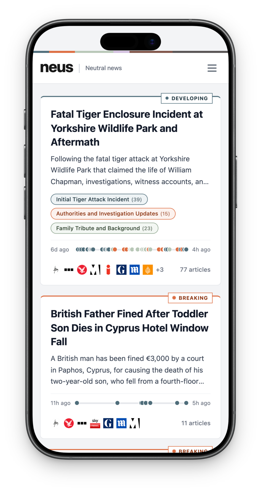

# Neus

**Live at [neus.news](https://neus.news)**

An automated, multi-angle news aggregation platform designed for editorial neutrality, algorithmic transparency and high-efficiency semantic clustering.

[](https://neus.news)

---

## Overview

Neus is an independent news aggregation platform that counters media polarisation, clickbait frequency manipulation and sensationalised reporting.

Rather than relying on engagement-driven algorithmic feeds or solitary outlet narratives, Neus groups related coverage across the political spectrum into unified, multi-perspective story clusters:

- **Multi-Angle Story Hierarchy**: Complex, developing news events are structured under an overarching story umbrella with distinct narrative angles (e.g. initial incident, investigations, legal fallout or political responses) rather than monolithic catch-all buckets.
- **Synthesised Neutral Summaries**: Compact, bias-free headlines and executive summaries generated via LLMs with strict factual constraints and multi-source attribution.
- **Consensus Recency & Anti-Gaming**: A dual-outlet consensus timestamp system that defeats single-source recency hijacking, preventing high-frequency tabloids from artificially resetting the recency clock.
- **Deterministic-First Architecture**: High-speed in-memory vector mathematics, cosine similarity pre-filtering and graph-based connected components handle heavy analytical lifting locally before invoking LLMs.

For the comprehensive 15-stage architectural reference and pipeline specification, see [`docs/architecture/pipeline.md`](./docs/architecture/pipeline.md).

---

## Architectural Pipeline

Neus operates as a continuous 15-stage automated pipeline orchestrated via GitHub Actions:

```
Sources (RSS) ➔ Content Extraction ➔ Batch Embeddings (768-dim)
       │
       ▼
Local Cosine Graph Clustering (DFS Connected Components)
       │
       ▼
Multi-Source Gating (≥ 2 distinct active sources)
       │
       ▼
Story Umbrella & Angle Neighborhood Organization (Cosine pre-filter + LLM disambiguation)
       │
       ▼
Consensus Recency Scoring & Trust Weighting ➔ Fastify/Mercurius GraphQL ➔ React Web App
```

### Core Pipeline Stages

1. **Feed Ingestion**: High-throughput RSS polling across mainstream UK and international outlets.
2. **Missing Content Extraction**: Readability-based DOM extraction with automatic skips for paywalled and failed domains.
3. **Batch Vector Embedding**: Dense 768-dimensional semantic embeddings generated in chunks of up to 100 articles via Google Gemini (`text-embedding-004`).
4. **Graph-Based Article Clustering**: Local cosine similarity matrix ($threshold = 0.88$) evaluated over a 3-day lookback window, grouped into connected components using depth-first search.
5. **Multi-Source Gating**: Solitary single-source clusters are withheld from publication until corroborated by at least two distinct active news organisations.
6. **Neutral Summarization**: Concurrent worker batches generating objective headlines and summaries via `gemini-flash-lite-latest` with automatic fallback to `gpt-4o-mini`.
7. **Multi-Angle Story Organization**: In-memory cosine similarity and graph neighborhoods group related clusters into overarching stories with distinct semantic angles, disbanding underpopulated candidates (< 2 angles) automatically.
8. **Consensus Feed Scoring**: Clusters are ranked using exponential recency decay, unique-source trust weighting and consensus recency.

---

## Editorial Scoring & Ranking

Neus uses an editorial scoring model designed to prioritize broad journalistic consensus without engagement metrics or click tracking:

$$\text{score} = \left(\text{coverage} \times 0.5 + \text{trust} \times 0.5\right) \times \text{recencyDecay}$$

### 1. Consensus Recency
To prevent a single high-frequency publication from resetting the feed clock with repeated minor updates, recency is anchored to the **second-newest distinct outlet timestamp** when two or more sources exist:

$$t_{\text{consensus}} = \begin{cases} \text{newest source timestamp} & \text{if } N_{\text{sources}} = 1 \\ \text{2nd newest source timestamp} & \text{if } N_{\text{sources}} \ge 2 \end{cases}$$

### 2. Recency Decay
Stories experience an exponential decay with a 24-hour half-life ($\lambda = \frac{\ln(2)}{24} \approx 0.02888$):

$$\text{recencyDecay} = e^{-\lambda \times \Delta t_{\text{hours}}}$$

### 3. Source Coverage & Trust
- **Coverage Breadth**: Logarithmic scaling based on unique publication count ($\sqrt{N_{\text{unique\_sources}}}$).
- **Source Trust**: Curated baseline trust score averaged across **unique publications** rather than raw article volume, eliminating the influence of syndication spam.

---

## Tech Stack & Monorepo Structure

```
neus/
├── apps/
│   ├── api/          # High-performance Fastify + Mercurius GraphQL server
│   ├── engine/       # Automated ingestion, clustering and AI pipeline
│   ├── web/          # React 18, Vite, Tailwind CSS, SVG sparklines and responsive UI
│   └── admin/        # Editorial administration prototype
├── packages/
│   └── db/           # Prisma client, PostgreSQL helpers, migrations and maintenance scripts
├── docs/
│   └── architecture/ # Canonical pipeline documentation and design specifications
└── .github/
    └── workflows/    # CI test and build gating + scheduled pipeline workflows
```

- **Runtime & Language**: Node.js 22 LTS, TypeScript across all packages.
- **Monorepo Management**: pnpm workspaces with isolated package boundaries.
- **Database**: PostgreSQL hosted on Neon (Serverless Postgres with native indexing).
- **API Layer**: Fastify with Mercurius GraphQL, DataLoader batching and in-memory caching.
- **Frontend**: React 18, Vite, Tailwind CSS, custom zero-dependency SVG sparklines and adaptive histogram binning.
- **CI/CD**: GitHub Actions workflows running automated dependency caching, Prisma client generation, full test suites and production build gates on pull requests and pushes to `main`.

---

## Local Development

### Prerequisites
- Node.js `>= 22.0.0`
- pnpm `>= 10.0.0`
- PostgreSQL (local instance or Neon database branch)
- Google Gemini API key and TypeSafe API key

### Getting Started

1. **Clone the repository and install dependencies**:
   ```bash
   git clone https://github.com/cobacious/neus.git
   cd neus
   pnpm install
   ```

2. **Configure Database**:
   ```bash
   cp packages/db/.env.example packages/db/.env
   # Add your DATABASE_URL in packages/db/.env
   pnpm db:generate
   pnpm db:migrate
   ```

3. **Configure Pipeline Engine**:
   ```bash
   cp apps/engine/.env.example apps/engine/.env
   # Add your GEMINI_API_KEY, TYPESAFE_API_KEY and DATABASE_URL
   ```

4. **Run Services Locally**:
   ```bash
   # Terminal 1: Start GraphQL API
   pnpm --filter @neus/api dev

   # Terminal 2: Start Web Application
   pnpm --filter @neus/web dev

   # Terminal 3: Run pipeline pass locally
   pnpm pipeline
   ```

5. **Run Verification & Tests**:
   ```bash
   # Run all 52 test suites (mocked AI, zero API cost)
   pnpm test

   # Run typecheck and production build
   pnpm build
   ```

---

## Design Principles

- **Deterministic First; LLM Last**: Every computation that can be handled using vector geometry, graph traversal, relational SQL or regex heuristics is executed locally. LLM calls are reserved strictly for natural language synthesis where semantic ambiguity exists.
- **Additive Migrations & Zero-Downtime Releases**: Database migrations are strictly additive (nullable columns, defaults, new tables) and decoupled from frontend deployments.
- **Zero Click Tracking**: No tracking cookies, user profiling or algorithmic engagement loops. Editorial value and corroboration dictate the feed.

---

## Screenshots

### Desktop View


### Mobile View

<p align="center">
  
</p>

---

## License

This codebase is open for public viewing, auditing and educational reference. For commercial reuse or syndication inquiries, please contact the repository owner.